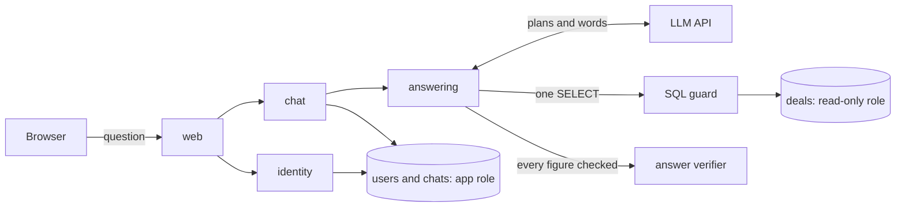
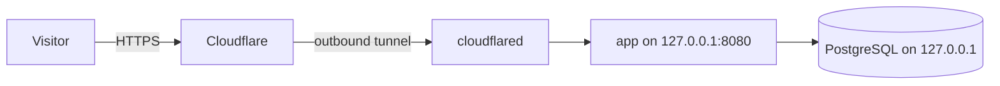

# System design

A web service that answers questions about 500,000 exchange deals in Russian and Uzbek. The rule that shapes everything: an invented number, company or product disqualifies the team, so the design never relies on the language model being right.

## Request flow



1. The browser posts a question and receives server-sent events as the agent works, including each query's rows as soon as it finishes. Rows are real data, so they can be shown early. The worded answer waits for the check below.
2. `chat` loads the conversation context from the database, never from the browser.
3. The model calls tools: `find_company`, `find_broker` and `run_sql`.
4. `SqlGuard` allows one `SELECT` over the published tables. The database role is read-only as well.
5. The model words an answer from the rows it received.
6. `DraftReviewer` checks every number, date and name against those rows. A failed draft gets one repair attempt.
7. If the draft still fails, the page shows the raw query result. An answer with no rows behind it becomes "no data".

## Packages

Packages follow features, and dependencies point one way:

```
web → chat → answering → dataquery
web → identity
chat ⇢ identity (implements GuestDataTransfer)
chat, identity → persistence
```

| Package | Responsibility |
|---|---|
| `web` | HTTP only: controllers, session cookie, rate limits, security headers |
| `chat` | Stored chats, and answering a question inside one |
| `answering` | The agent: conversation, tools, review, verification, responses |
| `dataquery` | Running validated, read-only SQL |
| `identity` | Guests, optional accounts, sessions |
| `persistence` | The connection for users and chats |
| `config` | Typed settings |

## SOLID in this code

| Principle | Where |
|---|---|
| Single responsibility | `AgentService` runs the flow, `DraftReviewer` judges drafts, `AgentResponses` builds responses, `AgentGate` limits concurrency |
| Open/closed | A new LLM provider means a new `LlmGateway`, with no change to the agent |
| Liskov substitution | The tests swap in a scripted `LlmGateway` and `QueryRunner` for the real ones, and the flow behaves the same |
| Interface segregation | `QueryRunner` and `GuestDataTransfer` each have one method. `PromptSource` exposes only what answering needs |
| Dependency inversion | `identity` defines `GuestDataTransfer` and `chat` implements it, so identity knows nothing about chats |

## Data

`db/init` builds everything from the CSVs on an empty volume. The CSVs are never changed.

| Schema | Holds | Who can read it |
|---|---|---|
| `raw` | The CSVs exactly as published, as text | Owner only |
| `public` | The clean model, with README rules as columns | Agent role (read-only) |
| `app` | Users, sessions, chats | App role only |

The agent's role cannot see `app`, so SQL written by the model cannot read anyone's chats. The app's role cannot see `public`, so a bug in account code cannot touch the deals.

## Identity

The rules require the prototype to work without registration, so accounts are optional.

- **Guests:** the first question creates a guest behind an HttpOnly, SameSite=Lax cookie. A guest's chats last until the page is reloaded, and the page says so. They are stored on the server meanwhile, because context comes from the stored chat. An hourly job removes guests older than a day, for pages that were closed and never reloaded.
- **Registered users:** chats are kept, and can be renamed and deleted. Deleting a chat also deletes its questions and answers.
- **Registering:** a guest becomes the account in place and keeps its chats, as long as the page was not reloaded first.
- **Signing in:** a guest's chats move to the account in one transaction, and the guest is removed.
- **Sessions:** only a SHA-256 hash of the token is stored, and the token changes at every sign-in.
- **Passwords:** BCrypt with strength 12. Sign-in gives the same refusal and does the same work for a wrong password and an unknown username.
- **Limits:** attempts are limited per address and per username.

## Deployment



The public site runs on one Ubuntu VM, with three containers started by Docker Compose: the database, the app and `cloudflared`. There is no Dockerfile. The app container runs the built jar on a stock Java 25 image.

- **No ports opened for the site:** the tunnel connects out to Cloudflare, so visitors never connect to the server directly. The app and the database listen only on `127.0.0.1`.
- **Visitor address:** only the tunnel can reach the app, so rate limits use Cloudflare's `CF-Connecting-IP` header. `X-Forwarded-For` is ignored there, because a visitor can write its first value.
- **Secrets:** the tunnel token is in its own file, separate from `.env`, so the app never receives it. Both files are readable only by their owner and stay out of git.
- **Slow LLM calls:** on the server a call gets 15 seconds and up to 3 retries, so a hung call is retried soon and all four tries stay inside the 75-second deadline. If they all fail, the page says the model is unavailable and shows no answer.
- **Restarts:** the containers restart with Docker, and the VM starts when its host computer starts.
- **Server-only settings:** the Compose additions for this server are kept on the server, not in this repository.
- **Cloudflare settings:** JS and CSS stay in Cloudflare's cache for up to 4 hours, so purge it after changing the code. Rocket Loader stays off, because it rewrites scripts that the Content Security Policy protects.

## Decisions

| Decision | Why | Cost |
|---|---|---|
| Cloudflare Tunnel rather than opening router ports | The server sits behind NAT, and a tunnel needs no router access or public address | Depends on Cloudflare, and on the domain's nameservers pointing there |
| SQL tools rather than embeddings | Exact totals need real aggregation over 500,000 rows | Depends on the model writing correct SQL, which the verifier does not judge |
| Code verifies answers, not the model | A prompt cannot guarantee anything | Rare correct drafts go to repair or to the raw table |
| Derived values stored as columns | The model selects correct values instead of working out currency, lots and annulled deals | The schema is wider and needs a rebuild to change |
| Answering continues if saving fails | Judges score answers, not chat history | That answer may be missing from history |
| Rate limits kept in memory | One process is enough for this stage | Limits reset on restart and would not work across several instances |

## Known limits

- The verifier checks figures and names, not meaning. A correct number from the wrong query, or a wrong sentence with no figures in it, can still pass.
- One VM runs everything, on one host computer connected over Wi-Fi. If the host, its power or its network fails, the site stops. Scaling out would need shared rate limits.
- The full restart chain from host to VM to containers has not been tested with a real reboot.
- Registered users cannot reset a forgotten password or delete their account yet.
- Reloading a guest's page in one tab clears the guest's chats in its other tabs. The next question there starts a new chat, without the earlier context.
- Cross-site protection relies on SameSite=Lax cookies and JSON request bodies, without separate CSRF tokens.
- `/api/ask` is unauthenticated and stores nothing. It exists for the test runner and shares the per-address limit logic.
